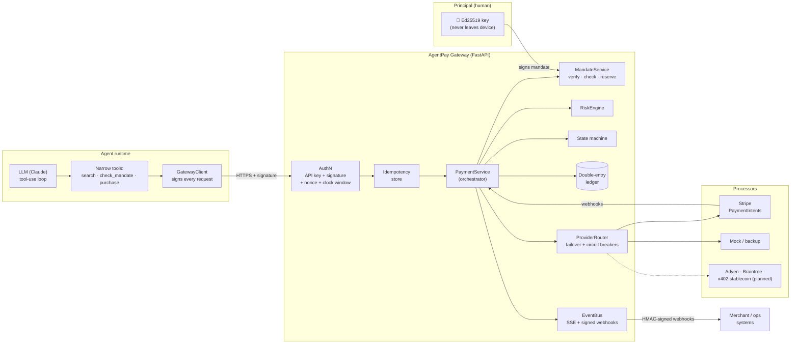
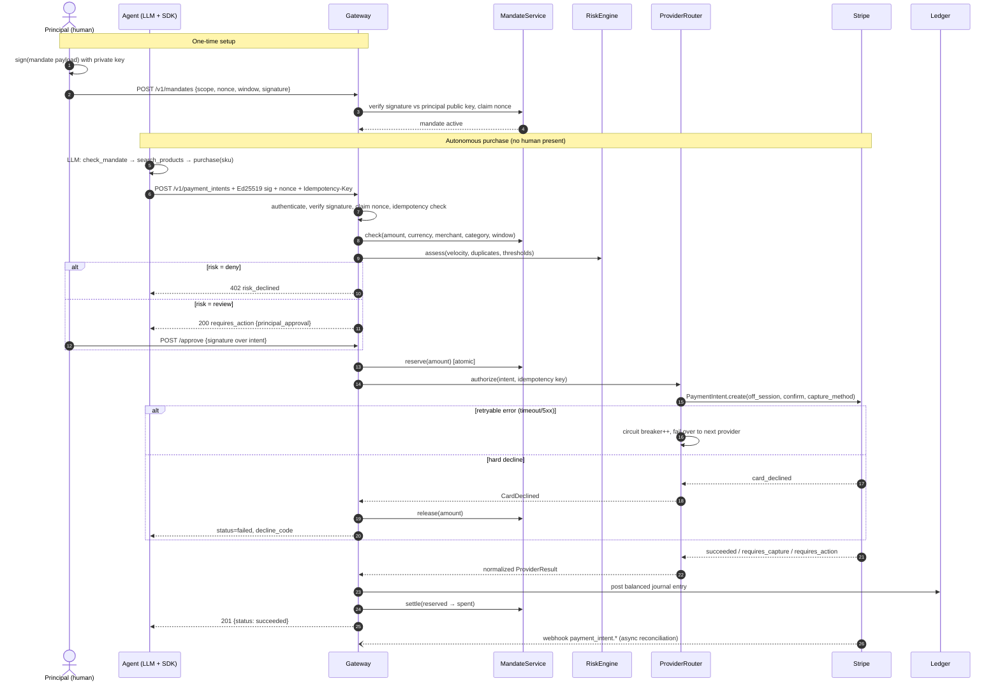
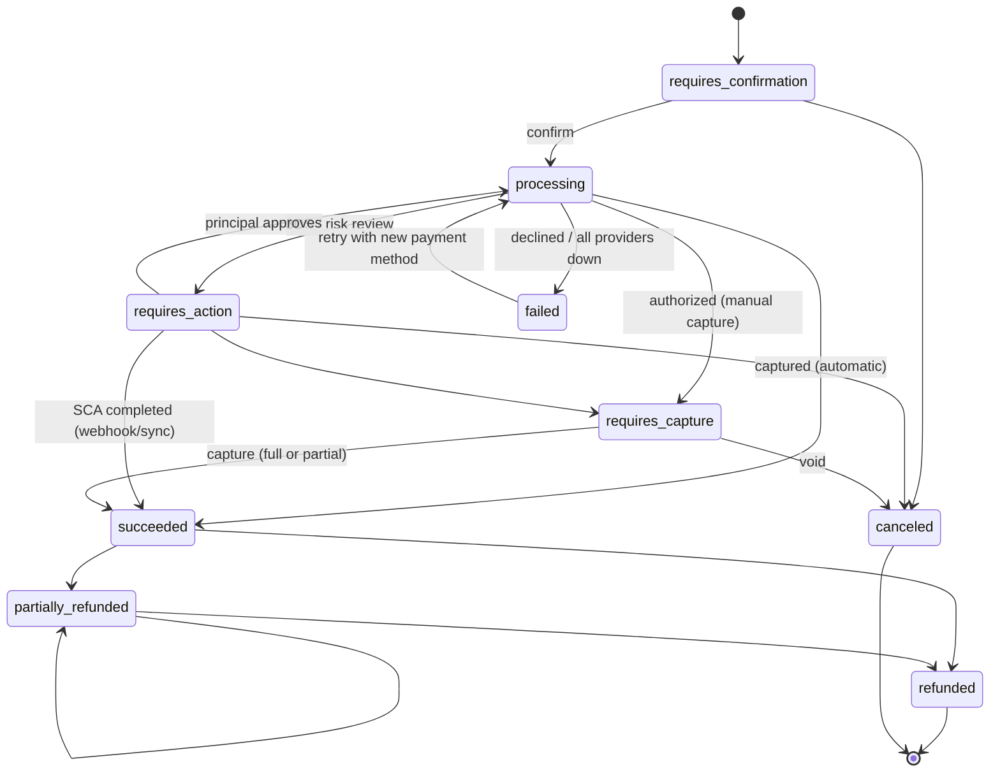
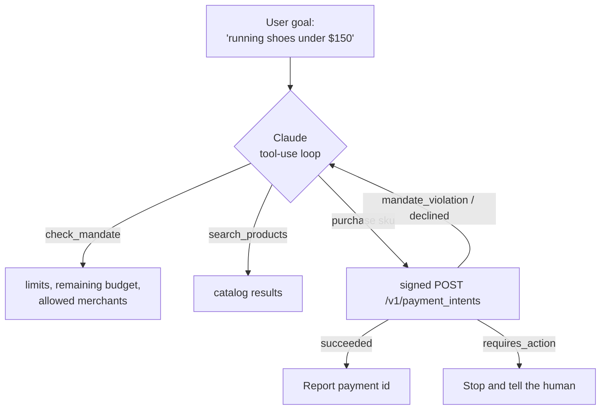

<div align="center">

# AgentPay: Agentic Payments Gateway

**A contactless, mandate-bound payment gateway that lets AI agents pay on a human's behalf, through any processor (starting with Stripe), without ever holding a card, a key or unlimited authority.**

[](https://github.com/tanvisht/Agentic-Payments-Gateway/actions/workflows/ci.yml)
 

`Live demo: coming with the frontend release`

</div>

---

## Contents

1. [Why this exists](#1-why-this-exists)
2. [Core ideas in 60 seconds](#2-core-ideas-in-60-seconds)
3. [System architecture](#3-system-architecture)
4. [End-to-end transaction flow](#4-end-to-end-transaction-flow)
5. [Payment-intent lifecycle](#5-payment-intent-lifecycle-state-machine)
6. [Trust model and cryptography](#6-trust-model-and-cryptography)
7. [Mandates: bounded delegation](#7-mandates-bounded-delegation)
8. [Provider layer: Stripe and beyond](#8-provider-layer-stripe-and-beyond)
9. [Risk engine for autonomous spend](#9-risk-engine-for-autonomous-spend)
10. [Ledger and reconciliation](#10-ledger-and-reconciliation)
11. [Reliability: idempotency, retries, crash recovery](#11-reliability-idempotency-retries-crash-recovery)
12. [The agent side](#12-the-agent-side)
13. [API reference](#13-api-reference)
14. [Running it](#14-running-it)
15. [Testing strategy](#15-testing-strategy)
16. [Repository layout](#16-repository-layout)
17. [Roadmap](#17-roadmap)

---

## 1. Why this exists

Card networks were built on a simple assumption: **the person tapping the card is the person who owns it.** AI agents break that assumption. When an agent books your flight or restocks your office, three questions have no good answer in today's rails:

| Question | Today | AgentPay |
|---|---|---|
| *Did the human actually authorize this?* | Agent holds a raw card or API key: all-or-nothing | Human signs a **scoped, expiring mandate** with their own key; the gateway verifies every payment against it |
| *Is this request really from that agent?* | Bearer token, replayable if leaked | **API key + Ed25519 request signature** with timestamp window and single-use nonce |
| *What happens when the agent misbehaves?* | Discovered on the statement | **Risk engine** tuned to agent failure modes (runaway loops, duplicates, prompt-injected merchants), plus human-in-the-loop escalation |

"Contactless" here means **no human in the loop at payment time**: the human's consent is captured once, cryptographically, as policy, and enforced on every transaction.

## 2. Core ideas in 60 seconds

- **Principal**: the human or org that owns the money and a signing key. Their private key never touches the gateway.
- **Agent**: an autonomous program with its own key pair and API key, registered under a principal.
- **Mandate**: a principal-signed JSON document: *"agent X may spend up to $200 per transaction, $500 total, USD only, at apple.com or sony.com, electronics and accesories only, until Friday."*
- **Payment intent**: one attempt to move money, driven through an explicit state machine.
- **Provider**: a pluggable processor adapter (Stripe today). The gateway routes, fails over, and normalizes.
- **Ledger**: an append-only double-entry journal; every cent is accounted for and reconcilable.

## 3. System architecture



**Design principles**

1. **Least authority by construction.** The LLM sees four narrow tools. The SDK holds the key. The gateway holds no private keys. The processor holds the card.
2. **Every state change is explicit.** No status string is assigned directly; `transition()` enforces the lifecycle graph.
3. **Money is integers.** Minor units only, `Decimal` with explicit rounding at the edges, ISO-4217 exponents (JPY=0, KWD=3).
4. **Network calls are never made while a DB transaction is open.** State is persisted before and after, so a crash mid-flight is recoverable.
5. **Provider-agnostic core.** Stripe-specific behavior lives only in `providers/stripe_provider.py`.

## 4. End-to-end transaction flow



## 5. Payment-intent lifecycle (state machine)



Budget side effects of each transition:

| Transition | Mandate effect | Ledger effect |
|---|---|---|
| create | `reserved += amount`, `txn_count += 1` | none |
| → `requires_capture` | (still reserved) | `principal:funding` Dr / `provider:held` Cr |
| → `succeeded` | `reserved -= amount`, `spent += captured` | move to `merchant:receivable` (releases any uncaptured remainder) |
| → `failed` / `canceled` | reservation released, count restored | void the hold if one existed |
| refund | `spent -= refunded` (budget restored) | `merchant:receivable` Dr / `principal:funding` Cr |

## 6. Trust model and cryptography

| Secret | Held by | Used for |
|---|---|---|
| Principal Ed25519 private key | Human's device / wallet | Signing mandates and approvals |
| Agent Ed25519 private key | Agent runtime (SDK) | Signing every gateway request |
| Agent API key | Agent runtime | Identification only (stored as SHA-256) |
| Processor secret key | Gateway (env / secret manager) | Talking to Stripe; live keys refused unless explicitly enabled |
| Card data | Processor only | Never seen by agent or gateway |

**Canonical signing.** Everything signed is canonical JSON (sorted keys, no whitespace, UTF-8), so an SDK in any language reproduces the exact bytes.

**Request signature** (agent → gateway):

```
X-AgentPay-Timestamp: 1763600000
X-AgentPay-Nonce:     9f0c…            (single use, stored until ts + tolerance)
X-AgentPay-Signature: b64url(Ed25519(canonical_json({
    "method": "POST", "path": "/v1/payment_intents",
    "timestamp": 1763600000, "nonce": "9f0c…",
    "body_sha256": "<hex sha256 of raw body>"
})))
```

Threats addressed: **a leaked API key** is useless without the signing key. **Replay** is blocked by the nonce store. **Delayed replay** is blocked by the ±300 s window. **Body tampering** is caught by the body hash. **A forged mandate** fails the principal-key verification. **An agent widening its own scope** changes the signed bytes, so verification fails. **Cross-agent access** returns 404, so other agents' resources are not even disclosed. Bodies are parsed only *after* authentication, so unauthenticated callers can't probe the schema.

## 7. Mandates: bounded delegation

```jsonc
// What the principal signs (agentpay.mandate.v1)
{
  "type": "agentpay.mandate.v1",
  "principal_id": "prn_…", "agent_id": "agt_…",
  "scope": {
    "currency": "USD",
    "max_amount_per_txn": 20000,      // $200.00
    "max_total_amount":   50000,      // $500.00 lifetime
    "merchants_allowed":  ["nike.com", "hoka.com"],
    "categories_allowed": ["running", "apparel"],
    "max_txn_count": 10,
    "requires_human_above": 15000     // > $150 escalates to the human
  },
  "nonce": "…", "not_before": 1763600000, "expires_at": 1764204800
}
```

Enforcement order: agent match → status → validity window → currency → per-txn limit → **remaining budget (spent + reserved)** → merchant → category → count. Reservation is atomic inside a serialized write transaction, so **N concurrent agent calls can never overspend**. Lifetime is capped at 90 days. Revocation is immediate.

## 8. Provider layer: Stripe and beyond

Every processor implements one interface:

```python
class PaymentProvider(ABC):
    def authorize(self, req: AuthorizeRequest) -> ProviderResult
    def capture(self, provider_ref, amount, idempotency_key) -> ProviderResult
    def cancel(self, provider_ref, idempotency_key) -> ProviderResult
    def refund(self, provider_ref, amount, idempotency_key, reason=None) -> ProviderResult
    def retrieve(self, provider_ref) -> ProviderResult
    def parse_webhook(self, payload, signature_header) -> WebhookUpdate | None
```

**Stripe adapter specifics**

- Off-session, merchant-initiated `PaymentIntent` with `confirm=true`. The principal saves a card once; the agent never sees it.
- `capture_method=manual` for authorize-then-capture flows (e.g. hotel holds), with partial capture.
- Stripe idempotency keys are **derived** from gateway keys (`auth:{intent}:{attempt}`), so a retried gateway call can't double-charge at Stripe.
- SCA: `authentication_required` on off-session becomes `requires_action` with the `next_action` surfaced to the principal.
- Error taxonomy: `CardError` → hard decline (no failover). `APIConnectionError`/`RateLimitError`/`APIError` → retryable (failover). `InvalidRequestError` → 422.
- Webhooks verified with `Stripe-Signature` and mapped to normalized updates (at-least-once safe).
- `sk_live_` keys are **refused** unless `AGENTPAY_ALLOW_LIVE_KEYS=true`.

**Routing.** Providers are tried in order (or a preferred one first), each behind a **circuit breaker** (closed → open after N retryable failures → half-open probe after cooldown). Only retryable errors fail over; an issuer decline is final, because re-trying a decline elsewhere is pointless and violates network rules.

**Adding a processor** = one file implementing the six methods plus a line in `gateway._build_providers`. The test suite's `MockProvider` doubles as the reference implementation.

## 9. Risk engine for autonomous spend

Agents fail differently from humans, so the rules target agent failure modes:

| Rule | Catches | Score |
|---|---|---|
| Velocity (N payments / window / agent) | Runaway tool loops | +90 |
| Duplicate (same agent + merchant + amount within window) | Retry storms, re-planning loops | +50 |
| Near per-txn limit (≥90%) | Hallucinated / inflated amounts | +20 |
| Mandate nearly exhausted (>95%) | Budget drain | +10 |
| Blocked merchant | Prompt-injected checkout pages | +100 |
| Above `requires_human_above` | Policy escalation | → review |

`score ≥ 80` → **deny** (402). `score ≥ 40` → **review**: the intent parks in `requires_action` until the principal signs an approval over `{intent_id, amount, currency, merchant_id}`.

## 10. Ledger and reconciliation

Append-only, double-entry, per currency. Balances are **derived**, never stored.

```
authorize   Dr principal:{id}:funding        Cr provider:{name}:held
capture     Dr provider:{name}:held          Cr merchant:{id}:receivable  (+ Cr principal:funding for uncaptured remainder)
direct      Dr principal:{id}:funding        Cr merchant:{id}:receivable
void        Dr provider:{name}:held          Cr principal:{id}:funding
refund      Dr merchant:{id}:receivable      Cr principal:{id}:funding
```

`GET /v1/ledger/trial_balance` must always return zeros. Every test that moves money asserts it.

## 11. Reliability: idempotency, retries, crash recovery

- **Idempotency-Key** (scoped per caller, 24 h): same key + same body → the stored response is replayed (`Idempotent-Replayed: true`). Same key + different body → 409. Key still in flight → 409, so two concurrent retries can never both charge.
- **Two-phase persistence**: the intent is saved as `processing` *before* the processor call. If the process dies mid-call, `POST /sync` or the provider webhook resolves it.
- **At-least-once webhooks in**: applying the same provider event twice is a no-op.
- **Signed webhooks out**: `AgentPay-Signature: t=…,v1=HMAC_SHA256(secret, "{t}.{body}")`, exponential-backoff redelivery.
- **Circuit breakers** isolate a failing processor without stopping traffic.

## 12. The agent side



- `agentpay/agent/tools.py` defines strict JSON-schema tools; the model can't pass a raw amount, only a SKU whose price comes from the catalog.
- `agentpay/agent/runner.py` runs a manual Messages API tool loop (`claude-opus-5-5` by default, override with `AGENTPAY_AGENT_MODEL`). Without `ANTHROPIC_API_KEY` it uses a deterministic planner that exercises the **identical** gateway path, which is how CI and offline demos run.

## 13. API reference

| Method & path | Auth | Purpose |
|---|---|---|
| `GET /healthz` | none | Liveness + provider circuit states |
| `POST /v1/principals` | admin | Register principal public key (+ default payment method) |
| `POST /v1/agents` | admin | Register agent; returns `api_key` **once** |
| `POST /v1/agents/{id}/status` | admin | Suspend / reactivate an agent |
| `POST /v1/mandates` | admin | Submit a principal-signed mandate |
| `GET /v1/mandates[/{id}]` | admin / owning agent | Read mandate + remaining budget |
| `POST /v1/mandates/{id}/revoke` | admin | Immediate revocation |
| `POST /v1/payment_intents` | **agent, signed** | Create + confirm a payment (Idempotency-Key supported) |
| `GET /v1/payment_intents[/{id}]` | admin / owning agent | Read intent (+ ledger entries) |
| `POST /v1/payment_intents/{id}/capture` | signed | Full or partial capture |
| `POST /v1/payment_intents/{id}/cancel` | signed | Void authorization |
| `POST /v1/payment_intents/{id}/refunds` | signed | Full or partial refund |
| `POST /v1/payment_intents/{id}/retry` | agent, signed | Retry a failed intent |
| `POST /v1/payment_intents/{id}/sync` | admin / owning agent | Reconcile with processor |
| `POST /v1/payment_intents/{id}/approve` | principal signature | Approve a risk-escalated payment |
| `POST /v1/providers/{name}/webhook` | provider signature | Inbound processor webhooks |
| `POST /v1/webhook_endpoints` | admin | Subscribe to signed outbound events |
| `GET /v1/events`, `/v1/events/stream` | admin | Event log, live SSE stream |
| `GET /v1/ledger/trial_balance`, `/balance` | admin | Accounting |

Errors are always `{"error": {"code", "message", "details?"}}` with stable codes: `authentication_failed`, `invalid_signature`, `replay_detected`, `mandate_violation`, `risk_declined`, `card_declined`, `invalid_state`, `idempotency_conflict`, `no_provider_available`, `validation_failed`, `not_found`.

## 14. Running it

```bash
pip install -e ".[dev,agent]"
```

```bash
agentpay demo "Buy running shoes under \$150"
```

```bash
AGENTPAY_ADMIN_KEY=dev-admin agentpay serve --port 8080
```

Stripe test mode:

```bash
export AGENTPAY_PROVIDERS=stripe,mock AGENTPAY_DEFAULT_PROVIDER=stripe STRIPE_SECRET_KEY=sk_test_... STRIPE_WEBHOOK_SECRET=whsec_...
```

```bash
stripe listen --forward-to localhost:8080/v1/providers/stripe/webhook
```

Docker:

```bash
docker build -t agentpay . && docker run -p 8080:8080 -e AGENTPAY_ADMIN_KEY=dev-admin agentpay
```

## 15. Testing strategy

```bash
pytest
```

| Layer | What's covered |
|---|---|
| Domain | Money rounding / exponents / mismatches, every legal and illegal state transition |
| Mandates | Forged, tampered and replayed mandates, every enforcement rule, expiry, revocation, reservation exhaustion |
| API security | Missing / wrong-key signatures, nonce replay, clock skew, suspended agents, cross-agent isolation, admin-only routes, auth-before-parse |
| Payments | Auto & manual capture, partial capture, multi-refund to zero, cancel/void, decline → release → retry, 3DS → sync, idempotent replay & conflict, overspend |
| Providers | Failover vs hard decline, all-down, circuit breaker open/half-open, Stripe param mapping, error translation, live-key guard, webhook signatures |
| Accounting | Unbalanced/invalid postings rejected, transaction rollback, trial balance = 0 after every flow |
| Agent | Deterministic agent buys within mandate; disallowed purchase surfaces as tool error |

## 16. Repository layout

```
agentpay/
├── core/          money · models · state machine · crypto · errors · idempotency · payments (orchestrator)
├── mandates/      signed mandate verification, enforcement, budget reservation
├── providers/     base interface · stripe_provider · mock · router (failover + circuit breakers)
├── risk/          agent-aware risk rules
├── ledger/        double-entry journal
├── webhooks/      outbound signing + delivery, event bus
├── storage/       SQLite document store (swap for Postgres)
├── api/           FastAPI app, auth, schemas
├── agent/         signed client SDK, LLM tools, Claude runner, demo
├── gateway.py     composition root
└── cli.py         `agentpay serve | demo`
tests/             pytest suite
```

## 17. Roadmap

- [x] Mandate-bound, signed agent payments with Stripe + failover
- [ ] Postgres store with row-level locking; horizontal scale
- [ ] x402 / USDC stablecoin provider and on-chain escrow adapter
- [ ] Stripe Connect payouts to merchant accounts
- [ ] Agentic Commerce Protocol (ACP) checkout endpoint compatibility
- [ ] Premium web frontend with live transaction visualizer and demo video
- [ ] OpenTelemetry tracing and Prometheus metrics

---

Built by [tanvisht](https://github.com/tanvisht). MIT licensed.
